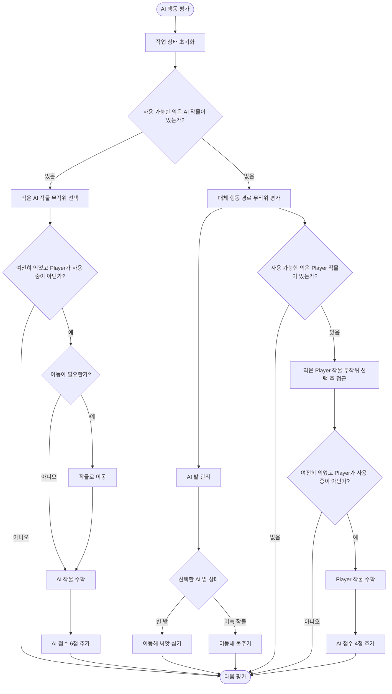

# The Boss (AI 농부) 안내

:::info 확인 범위
원본 저장소 `main` 커밋 `6221b11ba0926c9e6b49e781f6a2eb78285ffbbc` (2026-10-15)의 최신 Boss guide를 반영했습니다. 씬·Behavior Graph·AI 스크립트에 대한 정적 확인을 요약했으며 Unity에서 AI 경기를 실행해 난이도나 우선순위를 검증한 것은 아닙니다.
:::

## The Boss가 가리키는 대상

`MainGameScene`의 “The Boss”는 별도의 보스전이나 체력·전투 시스템을 가진 적이 아니라 Player와 점수를 겨루는 AI 농부(Enemy)를 가리킵니다. AI 흐름은 Unity Behavior Graph와 사용자 정의 동작이 함께 구성합니다. 현재 코드에서 Player가 보스를 직접 조작하는 입력은 확인되지 않았습니다.

## 경기 중 역할

- AI 농장에서 작물을 심고 물을 주어 성장시킵니다.
- 익은 자기 작물을 수확해 6점을 얻습니다.
- Player 밭의 익은 작물을 수확하면 4점을 얻습니다. Player도 기회가 있으면 AI의 익은 작물을 수확할 수 있습니다.
- 자기 작물을 수확할 때 무작위로 차량 또는 드론 아이템 보유 상태를 얻을 수 있습니다.
- 아이템 사용 시점은 고정 키 입력이 아닙니다. AI는 Player의 아이템 사용 여부, Player 밭 작물 상태, 무작위 결과 등의 조건을 확인해 차량이나 드론을 생성합니다.
- AI 차량과 드론의 흐름은 Behavior Graph, 사용자 정의 동작, 그래프의 Blackboard 설정이 함께 결정합니다.

## Behavior Graph 흐름

다음 그림은 AI의 주요 작업 분기를 플레이 관점에서 요약합니다. 애니메이션 초기화, 대기 중단 조건, 모든 예외 경로는 생략했습니다. `RandomComposite`가 포함되므로 매 평가마다 모든 작업을 순서대로 수행하는 것은 아닙니다.

AI는 먼저 자기 농장에서 수확 가능한 익은 작물이 있는지 확인하고, 있으면 그중 하나를 무작위 선택합니다. 대상이 더 이상 익지 않았거나 Player가 사용 중이면 작업을 진행하지 않습니다. 자기 밭에 익은 작물이 없을 때는 밭 관리와 Player 밭의 익은 작물 수확 경로를 무작위로 평가합니다. Player 밭 경로는 접근 뒤 상태를 다시 확인하므로, 그 사이 수확됐거나 Player가 사용하기 시작한 작물은 작업 대상에서 빠질 수 있습니다.

차량·드론 사용 판단은 이 그래프 흐름도에 포함되지 않으며 별도의 AI 아이템 조건에서 처리됩니다.

## 상대하는 방법

경기 제한 시간 동안 내 작물을 키워 수확하고, 기회가 있으면 AI가 작업 중이 아닌 익은 AI 작물을 수확해 점수를 얻습니다. 차량과 Toxic Drone은 작물 진행을 되돌릴 수 있고 Boost Drone은 소유자 농장의 작물 성장을 빠르게 합니다. 아이템의 현재 대상과 주의점은 [아이템 사용 안내](items-guide.md)를 참고하세요.

게임 난이도, AI 행동 우선순위, 상황별 실제 반응은 실행 테스트 전입니다. “Boss”라는 이름만으로 보스 체력전이나 특정 난이도를 가정하지 않습니다.
