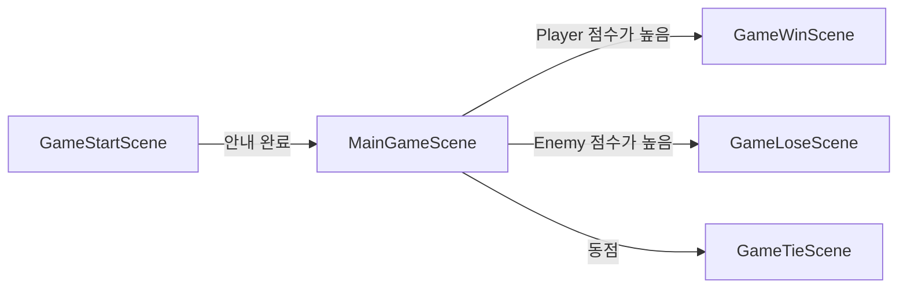
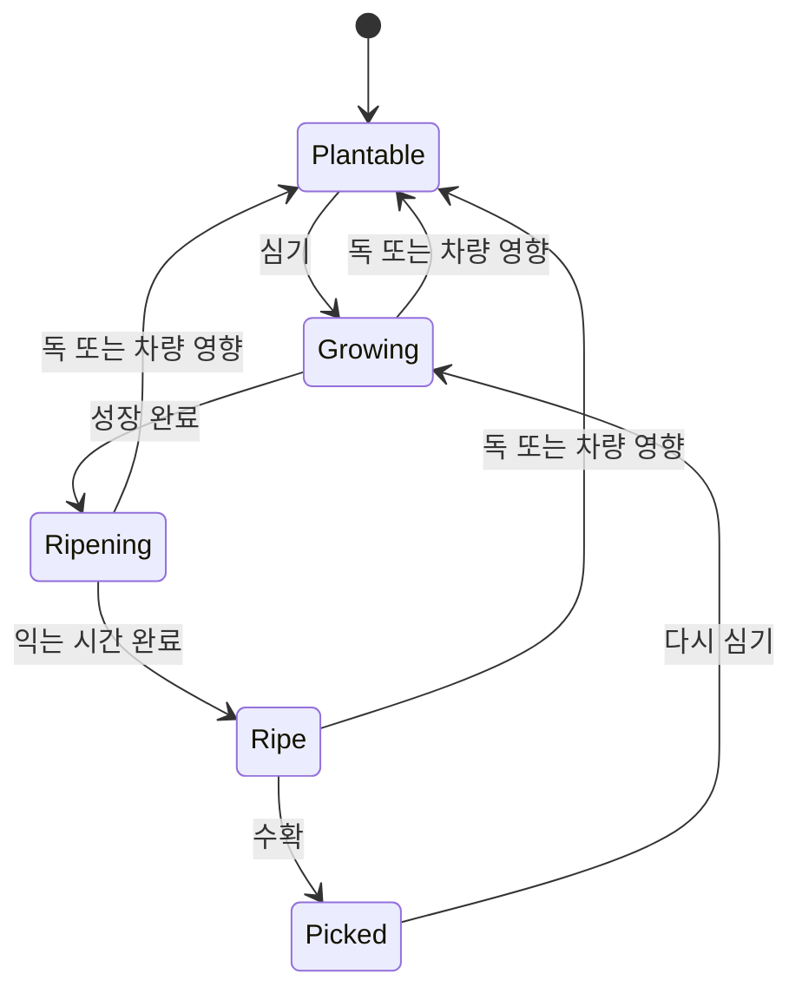

# 게임플레이 흐름

:::info 확인 범위
원본 `main` 커밋 `03e20da0eeef6350f2a26807811d81c55bea74dd`의 Docs와 프로젝트 설정을 기준으로 요약했습니다. Unity Editor에서 실행 검증한 결과는 아닙니다.
:::

## 씬과 경기 수명

활성 빌드 씬은 `GameStartScene`, `MainGameScene`, `GameWinScene`, `GameLoseScene`, `GameTieScene` 순서입니다. 시작 씬 안내를 마치면 경기가 시작되고, 300초가 지나면 Player와 Enemy 점수를 비교해 결과 씬으로 이동합니다. 경기 중 180초가 지나면 배경 음악이 전환됩니다.

## 작물 상태

빈 밭에 씨앗을 심고 물을 주면 성장 단계가 진행됩니다. 마지막 성장 단계에 도달하면 익는 시간을 거쳐 수확할 수 있습니다. 수확한 밭은 다시 심을 수 있는 상태가 됩니다.

기본 성장 간격은 2초이며, 마지막 단계 이후 익는 대기시간은 10초입니다. 물을 주는 동안 성장 타이머가 진행됩니다. Boost Drone은 이 시간을 줄이며, [아이템 사용 안내](items-guide.md)에 효과를 정리했습니다.

## Player와 AI 농부

Player는 로컬 입력으로 이동하고 작물과 상호작용합니다. AI 농부는 Unity Behavior Graph와 사용자 정의 동작을 이용해 자기 밭을 관리하고 아이템을 사용할 수 있습니다. 그래프 설정과 씬 상태도 AI 흐름에 영향을 주므로 C# 코드만으로 모든 행동 우선순위를 단정하지 않습니다.

## 멀티플레이어 경계

저장소에는 Netcode for GameObjects 등 네트워크 패키지가 포함되어 있지만, 확인한 게임 코드에서 네트워크 객체·변수·RPC 기반 상태 동기화를 확인하지 못했습니다. 따라서 서버 소유 점수 판정이나 클라이언트 간 작물 상태 복제를 구현 완료로 간주하지 않습니다. 멀티플레이어 관련 구현이 바뀌면 실제 적용된 네트워크 계약을 기준으로 이 문서를 갱신해야 합니다.
