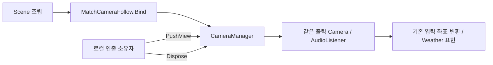

# CameraManager와 시점 전환

**중요 · 로컬 컷씬/연출을 연결할 때 읽습니다.** 2026-11-12 main `2cbc4542b` 기준으로 사용할 수 있습니다. namespace는 `TeamHJD.Game.Presentation.Scene`입니다.

## 무엇을 관리하나

`CameraManager`는 내 화면의 출력 Camera와 임시 시점을 관리합니다. 같은 출력 Camera의 XY 위치·회전·정사영 크기를 바꾸므로 컷씬마다 새 Camera를 생성할 필요가 없습니다. 기본 Player 추적은 `MatchCameraFollow`가 담당합니다.

`MatchCameraFollow.Awake`가 같은 객체의 CameraManager를 확보하고, Scene 조립의 기존 `Bind(localPlayer)`가 Player를 연결합니다. 임시 시점을 선택하는 동안 Follow는 transform 쓰기를 양보합니다. 연출이 끝나면 반환받은 lease를 해제해 이전 시점으로 돌아갑니다.



## 가장 작은 사용 예시

연출 소유자가 시작/종료를 호출합니다. 실제 자막·Letterbox·입력 잠금·게임 정지는 각 시스템에 따로 연결하세요.

```csharp
using System;
using TeamHJD.Game.Presentation.Scene;
using UnityEngine;

public sealed class LocalShot : MonoBehaviour
{
    private IDisposable _view;

    public bool TryBegin(Transform marker)
    {
        CameraManager camera = CameraManager.Current;
        if (camera == null || camera.ActiveTarget == null || marker == null)
            return false;

        EndShot();
        _view = camera.PushView(marker, blendSeconds: .3f, orthographicSize: 14f);
        return true;
    }

    public void EndShot()
    {
        _view?.Dispose();
        _view = null;
    }

    private void OnDisable() => EndShot();
}
```

marker는 로드된 Scene의 살아 있는 Transform이어야 합니다. 블렌드 0은 즉시 전환이고 양수는 부드러운 전환입니다. 정사영 크기는 양수여야 합니다. 연출 완료뿐 아니라 취소·오류·비활성화에서도 lease를 정리하세요.

| API | 사용 주체와 의미 |
| --- | --- |
| `CameraManager.Current` | 현재 로컬 출력. 조립 전에는 null일 수 있음 |
| `OutputCamera`, `ActiveTarget` | 실제 출력과 선택 대상 조회 |
| `PushView(target, blendSeconds, orthographicSize)` | 로컬 연출 소유자의 임시 시점 요청. 반환값을 보관 |
| `HasOverride`, `IsBlending` | 임시 시점/블렌드 여부 읽기 |
| `ViewChanged` | 같은 출력의 시점 변경 알림 |
| `OutputChanged` | 실제 로컬 출력이 바뀌는 확장에 사용. 구독자는 자신의 수명에서 해제 |

여러 요청에서는 마지막 살아 있는 요청이 우선입니다. 오래된 요청을 먼저 해제해도 나중에 되살아나지 않습니다. marker 삭제·actor 교체/해제·Scene 종료 시 과거 시점을 정리합니다. 게임 정지 중에도 로컬 블렌드는 진행합니다.

## 경계와 주의

- Player 전투·이동·입력 잠금·서버 권위를 소유하지 않습니다. 서버 사건은 각 Client의 로컬 연출 호출로 연결해야 합니다.
- 관리하는 출력이 여러 개면 하나의 Camera/AudioListener를 선택합니다. 관리부 없는 미니맵/보조 렌더 Camera까지 전역으로 끄지 않습니다. split-screen이나 원근 FOV 관리 API는 아닙니다.
- 포털의 기존 `SnapToTarget` 호출은 유지합니다. 이동 직후 현재 시점으로 즉시 맞추고 먼 거리를 날아오는 카메라 이동을 만들지 않습니다.
- 같은 출력 Camera를 유지하므로 기존 Weather/입력 참조를 불필요하게 교체하지 않습니다. 실제 출력 교체가 필요한 소비자는 `OutputChanged` 연결과 해제를 따로 인수해야 합니다.
- 제품 컷씬·대사·자막 재생기가 함께 구현된 것은 아닙니다.

[기능별 현재 상태](implementation-status.md) · [화면/입력·Scene API](api-reference.md)
