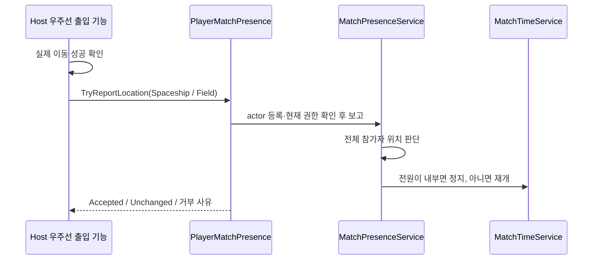

# 우주선 출입 보고와 Core 정지 API

SpaceshipEnter/Exit·Player NetworkBehaviour·포털 RPC는 이 API와 별도 연결이 필요합니다.

## 무엇을 보고하는 API인가

`PlayerMatchPresence.TryReportLocation`은 실제 Player가 어디에 **도착했는지**를 Host가 Core에 알리는 창구입니다. Feature가 전체 정지 여부를 직접 계산하거나 `Time.timeScale`을 바꾸지 않습니다. Core는 현재 Match의 참가자 위치를 보고 전원이 우주선 내부인지 판단해 기존 Match 시계를 정지·재개합니다.



## Host 이동 완료 뒤 호출

입장 요청, Scene 로드 시작, Client 로컬 Trigger 시점에는 보고하지 않습니다. Host가 이동을 검증·완료한 뒤 실제 actor의 `PlayerMatchPresence`를 찾아 호출합니다. 이동 실패면 위치도 갱신하지 않습니다.

```csharp
using TeamHJD.Game.Contracts;
using TeamHJD.Game.Domain;
using TeamHJD.Game.Presentation.Scene;

// Host가 실제 이동을 완료한 직후의 연결 예제입니다.
var reporter = player.GetComponentInParent<PlayerMatchPresence>();
if (reporter == null)
    return; // Core actor 등록이 먼저 필요합니다.

IPlayerMatchPresenceReporter api = reporter;
MatchPresenceReportStatus result =
    api.TryReportLocation(MatchPlayerLocation.Spaceship);

if (result != MatchPresenceReportStatus.Accepted &&
    result != MatchPresenceReportStatus.Unchanged)
{
    // result, api.MatchId, api.PlayerId로 등록·권한·종료 상태를 확인합니다.
}
```

필드 이동 완료 시에는 `MatchPlayerLocation.Field`를 보고합니다. `CanReport`는 사전 힌트일 뿐이며, 최종 처리는 반환 status로 판정합니다.

| 결과 | 의미와 다음 확인 |
| --- | --- |
| `Accepted` | 위치 변경을 접수함. 이 결과 하나만으로 전체 정지를 뜻하지 않음 |
| `Unchanged` | 같은 위치의 중복 보고. 성공이지만 revision·정지 전환을 중복 발생시키지 않음 |
| `Unavailable` | actor 미등록, lease 해제, Match 종료·취소. 이전 actor로 재보고하지 않음 |
| `NotAuthority` | Client actor 또는 Host 권한 상실. 전역 timeScale로 우회하지 않음 |
| `InvalidLocation` | 정의되지 않은 enum 값 |

## 전체 참가자와 정지 정책

- 1인 Match: 우주선 내부면 필드 정지, 밖이면 진행합니다.
- 2인 이상: **모든 참가자가 내부일 때만** 정지합니다. 한 명이라도 필드에 있으면 진행합니다.
- 미등록 참가자는 필드에 있는 것으로 취급합니다. 등록 누락으로 게임이 잘못 멈추지 않아야 합니다.
- 위치가 바뀌면 기존 `MatchTimeSceneReplication`이 Host 시간·확정 위치를 Client에 복제합니다.
- 저장·복원 등 다른 MatchTime 정지 lease가 있으면 출입에 따른 재개가 그 lease를 해제하지 않습니다.

개인 메뉴를 여는 것, 우주선 Scene을 계속 유지하는 것, 출입 위치를 보고하는 것은 서로 다른 책임입니다. `GameFlowController.ReturnToSpaceshipAsync()`는 Match를 종료하는 정식 귀환이며 전투 중 임시 방문에는 사용하지 않습니다.

## Player actor 등록과 수명

Host의 실제 network actor를 만든 뒤 등록하고, actor 교체·despawn·Match 종료에 반환 lease를 해제합니다.

```csharp
IDisposable registration =
    networkBinding.RegisterAuthorityPlayerActor(matchId, playerId, actualHostActor);
// actor가 사라지거나 교체될 때 registration.Dispose();
```

로컬 단독 Scene의 최초 Player는 `InitialStageCompositionRoot`가 연결합니다. 위치 등록만 별도로 해야 하면 `RegisterAuthorityPresence(playerId, actor)`를 사용합니다. 같은 Player 이중 등록은 거부합니다. `PlayerMatchPresence`를 임의로 AddComponent하는 것만으로 권한이 생기지 않습니다.

## RPC가 아니라는 점

이 API는 **Client → Host 포털 RPC를 제공하지 않습니다.** Client Trigger에서 `TryReportLocation`만 호출해도 서버로 전달되지 않습니다. Player·포털의 기존 네트워크 요청 경로에서 Host가 이동을 검증·완료한 뒤 Host actor로 이 API를 호출해야 합니다. 이 구현 배치에서는 Player NetworkBehaviour와 포털 RPC를 새로 추가·수정하지 않았습니다.

## 적용 범위와 한계

이 API는 실제 authored 포털 이동, 원격 Player 생성, Client→Host RPC 연결을 대신하지 않습니다. 해당 Feature가 기존 Host 경로를 붙인 뒤 별도 통합 검증이 필요합니다.

[Core 목차](../core.md) · [Core 호출·소유권 계약](contracts.md) · [Core 검증과 제한](testing.md)


## 현재 Feature 연결 구분 — main 1a03e9a9

`PlayerLocationState`는 로컬 카메라 날씨 효과 표시를 위한 위치 상태이며, Host의 `PlayerMatchPresence` 보고와 동일한 권한 원본이 아닙니다. `PlayerWeatherEffectBinding`이 우주선 안에서 화면 효과를 숨기는 것을 전원 우주선 판정·필드 AI/전력/예약 정지 완료로 해석하지 않습니다.

공용 정지/읽기 시간의 Core 계약은 main에 있지만 실제 Feature의 필드 시간 소비와 포털·원격 actor 연결은 별도로 확인해야 합니다. [현재 Map 구현](../world/progress.md)과 [시간 API](api-reference.md#공용-시간과-예약)를 함께 읽으세요.
