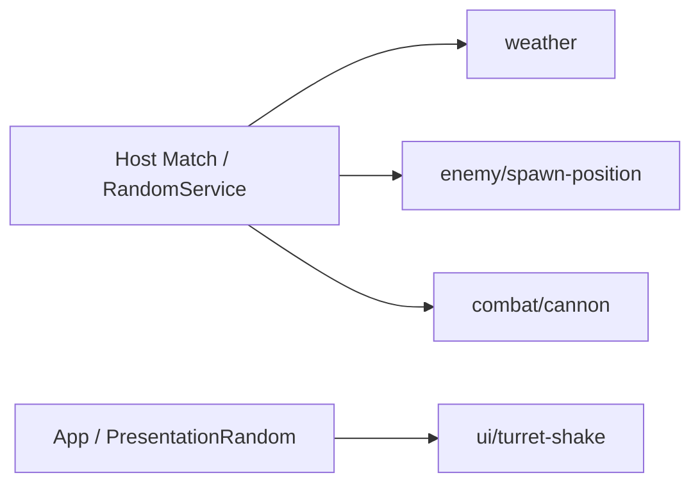

# Host 난수와 체크포인트 API

기존 게임 호출부는 아직 이 API로 교체되지 않았습니다. 날씨·적 생성·터렛·HUD 담당자는 아래 연결 방식과 호출 시점을 확인한 뒤 각 흐름을 적용합니다.

## 바로 사용하기

Feature에 새 부모 클래스를 붙이거나 등록·해제 클래스를 따로 만들지 않습니다. `IRandomConsumer`를 구현하고, 공용 정적 헬퍼로 필드를 한 번 연결합니다.

```csharp
using System;
using TeamHJD.Game.Application;
using TeamHJD.Game.Contracts;
using UnityEngine;

public sealed class WeatherRandomExample : MonoBehaviour, IRandomConsumer
{
    private IRandomSource _random;

    public IDisposable BindRandom(IRandomStreams streams)
        => RandomBinding.Bind(streams, "weather", ref _random);

    public int DrawWeatherRoll(int totalWeight)
        => _random.NextInt(0, totalWeight);
}
```

- 같은 Match Scene의 활성 `IRandomConsumer`는 Core가 Host 초기화 때 찾아 `BindRandom`을 호출하고 반환 lease를 보관·해제합니다.
- 최초 추첨은 `BindRandom` 뒤, Host 권위 환경이 준비된 실제 기능 초기화 시점에 합니다. `Awake`·Client `Start`에서 먼저 뽑지 않습니다.
- Client는 Host 결과 snapshot을 표시하며 권위 흐름을 직접 얻거나 같은 결과를 다시 뽑지 않습니다.
- Core가 lease를 해제하면 `_random`은 `null`이 아니라 사용 불가 참조가 됩니다. 준비 여부는 `_random != null && _random.IsAvailable`로 확인합니다.

`RandomBinding.Bind`는 활성 연결을 덮어쓰지 않습니다. 같은 필드에 이미 연결돼 있으면 거부하며, 기존 lease를 해제한 뒤에는 같은 필드를 다시 연결할 수 있습니다. 이전 lease를 다시 Dispose해도 새 연결에는 영향을 주지 않습니다.

## 왜 별도 난수 서비스인가

Unity 전역 난수를 여러 기능이 함께 쓰면 UI 연출의 호출 횟수만 바뀌어도 날씨·스폰·공격 결과가 달라질 수 있습니다. 이 API는 다음을 분리합니다.

- **전역 난수 결합 제거:** 이름별 흐름이 각자의 진행 상태를 갖습니다.
- **Host 권위:** 게임 판정 난수는 Host Match가 소유하며 Client가 다시 추첨하지 않습니다.
- **체크포인트 복원:** seed만이 아니라 실제 이름별 난수 진행 상태를 저장·복원합니다.



게임 판정은 Host Match의 `IRandomStreams`, 로컬 HUD·연출은 App의 `PresentationRandom`에서 받습니다. 같은 API를 쓰더라도 두 수명과 상태를 섞지 않습니다.

## 자동 Scene 연결과 직접 조립

동적으로 나중에 생긴 Feature와 순수 C# 객체는 Scene 자동 검색 대상이 아닙니다. 이 경우에는 **조립부**가 같은 헬퍼를 호출하고 반환 lease를 객체 수명에 맞춰 보관·해제합니다. 짧은 작업만 위한 예제라면 다음처럼 해제할 수 있습니다.

```csharp
IRandomSource random = null;
using (IDisposable binding = RandomBinding.Bind(
    streams, "enemy/spawn-position", ref random))
{
    var offset = random.InsideUnitCircle();
    // offset을 이 작업의 위치 계산에만 사용합니다.
}
// random.IsAvailable == false
```

계속 살아 있는 객체에 source를 전달했다면 작업 직후가 아니라 객체를 해제할 때 lease를 Dispose합니다. 동적 Feature는 Scene 조립부가 직접 Bind하고 lease를 소유합니다. `InitialStageCompositionRoot.Random` 및 `MatchSession.Random`도 초기화 전·Client에서는 `null`일 수 있으므로 Feature가 매 프레임 전역 검색하지 않습니다.

## 공통 추첨 API

정수와 실수 범위는 모두 **하한 포함·상한 제외**입니다. `min < max`가 아니거나 가중치가 음수·NaN·무한·전체 0이면 추첨 전에 거부합니다. Unity `Random.Range(float, float)`는 양 끝 포함이라는 차이가 있으므로 상한 포함 규칙은 교체 전에 따로 검토해야 합니다.

```csharp
using TeamHJD.Game.Application;
using TeamHJD.Game.Contracts;

// random은 BindRandom으로 전달받은 IRandomSource입니다.

// 기본 범위와 확률: 모두 상한 제외
int index = random.NextInt(0, 10);
float scatter = random.NextFloat(-.5f, .5f);
bool succeeded = random.Chance(.25); // 25%, 0/1은 추첨 없이 확정

// 균등 선택·가중치 선택·셔플
string[] weatherIds = { "sunny", "rain", "thunder" };
double[] weights = { 3d, 1d, 1d };
string uniform = random.Choose(weatherIds);
string weighted = random.WeightedChoose(weatherIds, weights);
int[] order = { 0, 1, 2, 3 };
random.Shuffle(order); // 호출자 배열을 제자리에서 변경

// 원판 면적에 균일한 좌표
var offset = random.InsideUnitCircle();
```

`NextBool`, `NextUInt32`, `NextFloat()`·`NextDouble()`(0 이상 1 미만), `WeightedIndex`, `WeightedChoose`도 제공합니다. 빈 목록은 `Choose`할 수 없고, 가중치 0 항목은 선택 대상에서 제외됩니다. 동일 이름은 동일 상태를 공유하므로 해당 Feature 안의 호출 순서는 결과에 영향을 줍니다.

## 게임 흐름과 연출 흐름을 섞지 않기

| 목적 | 흐름 | 예시 |
| --- | --- | --- |
| 날씨·스폰·전투 판정 | Host Match | `weather`, `enemy/spawn-position`, `combat/cannon` |
| HUD 흔들림·로컬 연출 | App 수명 | `ui/turret-shake` |

```csharp
// app은 조립부가 소유한 AppRoot 인스턴스입니다.
IRandomSource uiRandom = app.PresentationRandom.GetStream("ui/turret-shake");
float offsetX = uiRandom.NextFloat(-1f, 1f) * shakeAmount;
float offsetY = uiRandom.NextFloat(-1f, 1f) * shakeAmount;
```

App 연출 난수는 체크포인트에 저장하지 않습니다. Match 난수는 `MatchConfig.RandomSeed`로 시작하며, 기능마다 `RandomService`를 새로 만들거나 프레임·InstanceId로 흐름 이름을 만들지 않습니다.

일반 static 계산 함수는 `IRandomSource`를 매개변수로 받으면 됩니다. `IRandomConsumer`나 별도 부모 클래스가 필요하지 않습니다.

```csharp
public static class CombatRolls
{
    public static bool IsCritical(IRandomSource random, double chance)
        => random.Chance(chance);
}

// Feature에서: CombatRolls.IsCritical(_random, 0.1);
```

## 체크포인트 writer 등록

Core 난수 writer는 알고리즘 버전·seed·이름별 상태를 기록합니다. Feature는 자신의 실제 상태 writer도 별도로 등록해야 하며, 이 writer 하나가 전체 게임 저장을 보장하지 않습니다.

```csharp
ICheckpointParticipant randomWriter = scene.CreateRandomCheckpointParticipant();
participants.Add(randomWriter);
requiredKeys.Add(randomWriter.Key); // core/random

// 기존 Feature writer와 requiredKeys를 함께 전달해 CreateCheckpointScope를 조립합니다.
```

`core/random`이 필수인 체크포인트에 해당 데이터가 없으면 새 난수를 조용히 만들지 않고 기존 체크포인트 검증에서 거부합니다. 저장 이후 새로 만들어진 흐름은 초기 상태로 돌아갑니다. PCG32는 게임용 의사 난수이며 인증 토큰·백엔드 보상 검증·전체 AI/물리 결정적 리플레이 용도가 아닙니다.

## 기존 호출부 교체 계획 — 아직 미수정

현재 실행 소스의 직접 난수 소비는 **6개 파일, 7개 호출부**입니다. 이 API 배치에서는 아래 파일을 수정하지 않습니다.

| 파일 | 현재 목적 | 이후 연결 |
| --- | --- | --- |
| `Map/WeatherManager.cs` | 날씨·예고 큐의 정수 추첨 | Match `weather`의 `NextInt` |
| `Enemy/Spawning/EnemySpawnExecutor.cs` | SpawnPoint 반경 원판 분산 | `enemy/spawn-position`의 `InsideUnitCircle()` |
| `FieldCanonTurretLv1.cs` | 발사 X 오차 | `combat/cannon`의 `NextFloat(-.5f, .5f)` |
| `FieldCanonTurretLv2.cs` | 각 발사 방향 오차 | 같은 흐름, 기존 호출 순서 유지 검토 |
| `FieldCanonTurretLv3.cs` | Lv2와 같은 방향 오차 | 같은 흐름 또는 안정적 논리 ID 분리 검토 |
| `UI/Turrets/TurretInteractionUI.cs` | X/Y HUD 흔들림 두 추첨 | App `ui/turret-shake`의 두 `NextFloat` |

주석 상태인 `FieldLaserTurret.cs` 난수와 `Guid.NewGuid()` 기반 ID 생성은 실행 추첨 교체 대상이 아닙니다. Cannon의 Transform X 누적 조준 동작도 난수 API 교체와 함께 임의로 고치지 않습니다.

## 적용 범위와 한계

이 API만으로 Weather·Enemy·터렛·HUD의 기존 호출이 자동 교체되지는 않습니다. 각 담당자는 위 방식으로 Host 흐름 또는 App 연출 흐름을 연결한 뒤 실제 게임 흐름을 검증해야 합니다. 체크포인트 writer는 난수 진행 상태만 저장하며, Feature의 실제 상태 writer를 대신하지 않습니다.

[Core 목차](../core.md) · [Core API 사용법](api-reference.md) · [Core 검증과 제한](testing.md)
