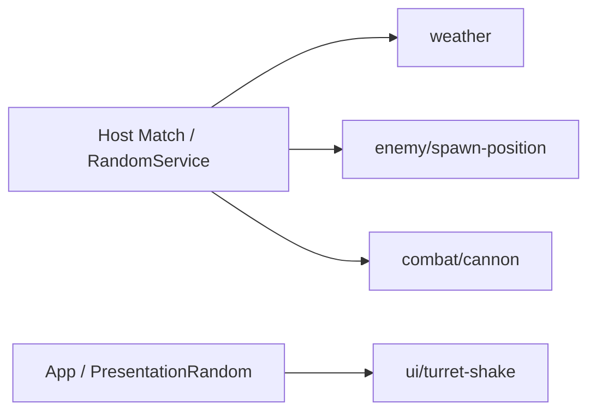

# Host 난수와 체크포인트 API

게임 판정은 Host Match가 전달한 난수로, 로컬 연출은 App 난수로 계산합니다. 날씨·적 생성·터렛·HUD 담당자는 아래 연결 방식과 호출 시점을 확인합니다.

**날씨별 빈도가 달라야 하면 [가중 선택·비 50% 예제](#weighted-weather)를 확인하세요.** `WeightedChoose`·`WeightedIndex`는 이미 제공하며, 두 가지 성공/실패 판정에는 `Chance(0.5)`를 사용합니다.

## 바로 사용하기

Feature에 새 부모 클래스를 붙이거나 등록·해제 클래스를 따로 만들지 않습니다. `IRandomConsumer`를 구현하고, 공용 정적 헬퍼로 필드를 한 번 연결합니다.

```csharp
using System;
using TeamHJD.Game.Application;
using TeamHJD.Game.Contracts;
using UnityEngine;

public sealed class WeatherRandomExample : MonoBehaviour, IRandomConsumer
{
    private IRandomSource _random;

    public IDisposable BindRandom(IRandomStreams streams)
        => RandomBinding.Bind(streams, "weather", ref _random);

    public int DrawWeatherRoll(int totalWeight)
        => _random.NextInt(0, totalWeight);
}
```

- 같은 Match Scene의 활성 `IRandomConsumer`는 Core가 Host 초기화 때 찾아 `BindRandom`을 호출하고 반환 lease를 보관·해제합니다.
- 최초 추첨은 `BindRandom` 뒤, Host 권위 환경이 준비된 실제 기능 초기화 시점에 합니다. `Awake`·Client `Start`에서 먼저 뽑지 않습니다.
- Unity `Start`도 주입 완료 신호가 아닙니다. `BindRandom`은 source를 **연결만** 하며, Weather의 첫 선택·예고 큐는 이후 환경 `BindAuthority`처럼 실제 Feature 시작을 보장하는 지점에서 만듭니다.
- Client는 Host 결과 snapshot을 표시하며 권위 흐름을 직접 얻거나 같은 결과를 다시 뽑지 않습니다.
- Core가 lease를 해제하면 `_random`은 `null`이 아니라 사용 불가 참조가 됩니다. 준비 여부는 `_random != null && _random.IsAvailable`로 확인합니다.

`RandomBinding.Bind`는 활성 연결을 덮어쓰지 않습니다. 같은 필드에 이미 연결돼 있으면 거부하며, 기존 lease를 해제한 뒤에는 같은 필드를 다시 연결할 수 있습니다. 이전 lease를 다시 Dispose해도 새 연결에는 영향을 주지 않습니다.

## 왜 별도 난수 서비스인가

Unity 전역 난수를 여러 기능이 함께 쓰면 UI 연출의 호출 횟수만 바뀌어도 날씨·스폰·공격 결과가 달라질 수 있습니다. 이 API는 다음을 분리합니다.

- **전역 난수 결합 제거:** 이름별 흐름이 각자의 진행 상태를 갖습니다.
- **Host 권위:** 게임 판정 난수는 Host Match가 소유하며 Client가 다시 추첨하지 않습니다.
- **체크포인트 복원:** seed만이 아니라 실제 이름별 난수 진행 상태를 저장·복원합니다.



게임 판정은 Host Match의 `IRandomStreams`, 로컬 HUD·연출은 App의 `PresentationRandom`에서 받습니다. 같은 API를 쓰더라도 두 수명과 상태를 섞지 않습니다.

## 자동 Scene 연결과 직접 조립

동적으로 나중에 생긴 Feature와 순수 C# 객체는 Scene 자동 검색 대상이 아닙니다. 이 경우에는 **조립부**가 같은 헬퍼를 호출하고 반환 lease를 객체 수명에 맞춰 보관·해제합니다. 짧은 작업만 위한 예제라면 다음처럼 해제할 수 있습니다.

```csharp
IRandomSource random = null;
using (IDisposable binding = RandomBinding.Bind(
    streams, "enemy/spawn-position", ref random))
{
    var offset = random.InsideUnitCircle();
    // offset을 이 작업의 위치 계산에만 사용합니다.
}
// random.IsAvailable == false
```

계속 살아 있는 객체에 source를 전달했다면 작업 직후가 아니라 객체를 해제할 때 lease를 Dispose합니다. 동적 Feature는 Scene 조립부가 직접 Bind하고 lease를 소유합니다. `InitialStageCompositionRoot.Random` 및 `MatchSession.Random`도 초기화 전·Client에서는 `null`일 수 있으므로 Feature가 매 프레임 전역 검색하지 않습니다.

### 호출이 안 될 때

| 증상 | 확인할 것 |
| --- | --- |
| `_random`이 `null` | Core의 `BindRandom` 호출 전인지, 소비자가 같은 Match Scene에서 활성화됐는지 확인합니다. 중간 생성 객체는 소유 조립부가 직접 연결합니다. |
| `IsAvailable`이 `false` | 해제된 연결이거나 Host 권한·Match 수명이 끝난 상태입니다. Client의 로컬 난수로 게임 판정을 대신하지 않습니다. |
| 이미 연결됐다는 오류 | 자동 연결 외에 `Awake`·`Start`에서 중복 등록하지 않았는지 확인하고, 기존 반환값은 소유 조립부에서 해제합니다. |
| `Chance`·`Choose`가 보이지 않음 | `using TeamHJD.Game.Application;`을 추가합니다. |
| 범위·가중치 오류 | `min < max`, 빈 목록 아님, 항목/가중치 수 일치, 0보다 큰 가중치가 하나 이상인지 확인합니다. |

## 공통 추첨 API

정수와 실수 범위는 모두 **하한 포함·상한 제외**입니다. `min < max`가 아니거나 가중치가 음수·NaN·무한·전체 0이면 추첨 전에 거부합니다. Unity `Random.Range(float, float)`는 양 끝 포함이라는 차이가 있으므로 상한 포함 규칙은 교체 전에 따로 검토해야 합니다.

```csharp
using TeamHJD.Game.Application;
using TeamHJD.Game.Contracts;

// random은 BindRandom으로 전달받은 IRandomSource입니다.

// 기본 범위와 확률: 모두 상한 제외
int index = random.NextInt(0, 10);
float scatter = random.NextFloat(-.5f, .5f);
bool succeeded = random.Chance(.25); // 25%, 0/1은 추첨 없이 확정

// 균등 선택·가중치 선택·셔플
string[] weatherIds = { "sunny", "rain", "thunder" };
double[] weights = { 3d, 1d, 1d };
string uniform = random.Choose(weatherIds);
string weighted = random.WeightedChoose(weatherIds, weights);
int[] order = { 0, 1, 2, 3 };
random.Shuffle(order); // 호출자 배열을 제자리에서 변경

// 원판 면적에 균일한 좌표
var offset = random.InsideUnitCircle();
```

`NextBool`, `NextUInt32`, `NextFloat()`·`NextDouble()`(0 이상 1 미만), `WeightedIndex`, `WeightedChoose`도 제공합니다. 빈 목록은 `Choose`할 수 없고, 가중치 0 항목은 선택 대상에서 제외됩니다. 동일 이름은 동일 상태를 공유하므로 해당 Feature 안의 호출 순서는 결과에 영향을 줍니다.

## 날씨 가중 선택 {#weighted-weather}

일반 목록 선택은 `Choose`, 서로 다른 빈도로 한 항목을 고를 때는 **`WeightedChoose`**를 사용한다. 이미 제공하는 API이므로 Weather 전용 난수 서비스나 별도 가중 추첨기를 추가하지 않는다. `WeightedIndex`는 같은 규칙으로 목록의 인덱스만 반환한다.

### 날씨 세 종류 중 하나 선택

아래는 **비 50% / 맑음 30% / 천둥 20%** 예제다. 실제 게임 확률을 이 값으로 변경한다는 뜻은 아니다. 날씨 종류·가중치·호출 시점은 World/Weather가 정하고, Core는 주입된 난수로 선택만 수행한다.

```csharp
using TeamHJD.Game.Application;
using TeamHJD.Game.Contracts;

public static class WeatherSelectionExample
{
    // 예제 ID다. 실제 Weather enum/정의 목록과 연결하는 것은 호출자의 책임이다.
    private static readonly string[] WeatherIds = { "rain", "sunny", "thunder" };
    private static readonly double[] WeatherWeights = { 50d, 30d, 20d };

    // random은 Host Match에서 BindRandom으로 이미 받은 source다.
    public static string SelectNextWeather(IRandomSource random)
        => random.WeightedChoose(WeatherIds, WeatherWeights);
}
```

기존 `IRandomConsumer.BindRandom`에서 `RandomBinding.Bind(streams, "weather", ref _random)`으로 한 번 연결한 뒤, 실제 날씨 선택 시점에 `WeatherSelectionExample.SelectNextWeather(_random)`을 호출하면 된다. 순수 함수 예제라 새 MonoBehaviour를 Scene에 배치하거나 새 부모 클래스를 상속하지 않는다. 목록과 가중치는 매 추첨마다 생성하지 않고 기존 Feature 데이터/필드로 재사용한다.

Core 연결 전 `Awake`에서 추첨하지 않는다. Client도 별도로 추첨하지 않고 Host가 확정한 날씨를 표시한다. 난수 주입·해제는 [이 페이지의 주입 방법](#바로-사용하기)의 규칙을 따른다.

| 항목 | 가중치 | 선택 확률 |
| --- | ---: | ---: |
| rain | 50 | 50 / 100 = 50% |
| sunny | 30 | 30 / 100 = 30% |
| thunder | 20 | 20 / 100 = 20% |

가중치는 **확률 값 자체가 아니라 상대 비율**이다. `[50, 30, 20]`, `[5, 3, 2]`, `[0.5, 0.3, 0.2]`는 같은 비율이다. 합이 100일 필요는 없으며 각 확률은 `해당 가중치 / 전체 양수 가중치 합`이다. 반대로 `[50, 1, 1]`은 비 50%가 아니라 약 96.15%다.

선택은 매번 독립적인 의사 난수 추첨이다. 비 50%는 **10회 중 정확히 5회 비가 온다는 보장이나 최근 날씨를 고르게 섞는 정책이 아니다.** 같은 날씨가 연속 나올 수 있다. 중복 금지·쿨다운·예고 큐·낮밤별 가중치 변경은 Weather의 별도 정책이며 Core가 몰래 추가하지 않는다. 이전 날씨를 0 가중치로 제외하면 남은 항목으로 확률이 다시 계산된다.

### 두 가지 판정이면 Chance

```csharp
bool shouldRain = random.Chance(0.5); // 비가 온다 / 오지 않는다, 50%
```

`Chance` 입력은 **0~1**이다. `Chance(50)`가 아니다. 맑음/비/천둥 중 **정확히 하나**를 선택하려면 `WeightedChoose`를 한 번 호출한다. 종류별로 `Chance`를 여러 번 호출하면 둘 이상 또는 아무것도 선택되지 않을 수 있다.

### 데이터로 인덱스만 선택

```csharp
int selectedIndex = random.WeightedIndex(weights);
var selectedDefinition = weatherDefinitions[selectedIndex];
```

`weights`와 정의 목록의 순서·개수는 호출자가 맞춘다. 항목 자체를 전달할 수 있으면 `WeightedChoose(weatherDefinitions, weights)`가 개수 불일치도 검사해 준다. enum·ScriptableObject·문자열 등 목록 항목 형식에 제한을 두지 않는다.

### 잘못된 설정의 처리

| 설정 | 결과 |
| --- | --- |
| 어떤 항목의 가중치가 0 | 해당 항목은 선택하지 않음 |
| 빈 목록 또는 모든 가중치가 0 | `ArgumentException` |
| 음수·NaN·무한 가중치 | `ArgumentOutOfRangeException` |
| 항목/가중치 개수가 다름 | `ArgumentException` |
| null 목록 | `ArgumentNullException` |
| 해제된 source 또는 Host 권한이 없음 | 기존 수명/권한 검사에서 거부 |

유효하지 않은 설정을 균등 선택으로 대체하지 않는다. 잘못된 데이터는 추첨 전에 수정한다. 가중치를 최댓값으로 정규화하므로 큰 유한 가중치들의 합이 overflow하는 경우도 처리한다. 가중치를 극단적으로 작게 섞으면 double 표현/난수 해상도의 한계가 있으므로 실제 게임 설정은 읽기 쉬운 비율로 유지한다.

### 상태와 저장 책임

가중 선택도 기존 `weather` 난수 흐름을 한 번 진행시킨다. 같은 seed·흐름 상태·호출 순서·가중치 목록이면 재현할 수 있다. Core의 `core/random` writer는 난수 진행 상태를 저장하고, 실제 날씨·예고 큐·가중치 정책의 실행 상태는 Weather writer가 저장한다. 난수 저장만으로 전체 Weather 저장이 완성되는 것은 아니다.

### 확인한 범위

2026-11-05, Unity 6000.3.23f1의 격리 검사 **13/13, 종료 0**. 위 예제와 같은 선택 함수를 실제 API로 컴파일하고 확률 경계·0 제외·비율 동일성·큰 가중치·잘못된 데이터·권한/해제·저장 복원 후 선택열을 확인했다.

고정 seed 100,000회에서 비 **50,151**, 맑음 **29,807**, 천둥 **20,042**회였다. 이는 이 실행의 분포 확인이며 실제 Weather 콘텐츠가 이 예제 확률을 사용하거나 짧은 구간에서 정확한 비율을 보장한다는 뜻은 아니다. 검사 코드는 개인 검증 자료에만 보관한다.

이 작업은 기존 API 확인과 사용법 보강이다. 김진태의 Weather 선택 코드·예고 큐·날씨 수치를 수정하지 않는다.

## 게임 흐름과 연출 흐름을 섞지 않기

| 목적 | 흐름 | 예시 |
| --- | --- | --- |
| 날씨·스폰·전투 판정 | Host Match | `weather`, `enemy/spawn-position`, `combat/cannon` |
| HUD 흔들림·로컬 연출 | App 수명 | `ui/turret-shake` |

```csharp
// app은 조립부가 소유한 AppRoot 인스턴스입니다.
IRandomSource uiRandom = app.PresentationRandom.GetStream("ui/turret-shake");
float offsetX = uiRandom.NextFloat(-1f, 1f) * shakeAmount;
float offsetY = uiRandom.NextFloat(-1f, 1f) * shakeAmount;
```

App 연출 난수는 체크포인트에 저장하지 않습니다. Match 난수는 `MatchConfig.RandomSeed`로 시작하며, 기능마다 `RandomService`를 새로 만들거나 프레임·InstanceId로 흐름 이름을 만들지 않습니다.

일반 static 계산 함수는 `IRandomSource`를 매개변수로 받으면 됩니다. `IRandomConsumer`나 별도 부모 클래스가 필요하지 않습니다.

```csharp
public static class CombatRolls
{
    public static bool IsCritical(IRandomSource random, double chance)
        => random.Chance(chance);
}

// Feature에서: CombatRolls.IsCritical(_random, 0.1);
```

## 체크포인트 writer 등록

Core 난수 writer는 알고리즘 버전·seed·이름별 상태를 기록합니다. Feature는 자신의 실제 상태 writer도 별도로 등록해야 하며, 이 writer 하나가 전체 게임 저장을 보장하지 않습니다.

```csharp
ICheckpointParticipant randomWriter = scene.CreateRandomCheckpointParticipant();
participants.Add(randomWriter);
requiredKeys.Add(randomWriter.Key); // core/random

// 기존 Feature writer와 requiredKeys를 함께 전달해 CreateCheckpointScope를 조립합니다.
```

`core/random`이 필수인 체크포인트에 해당 데이터가 없으면 새 난수를 조용히 만들지 않고 기존 체크포인트 검증에서 거부합니다. 저장 이후 새로 만들어진 흐름은 초기 상태로 돌아갑니다. PCG32는 게임용 의사 난수이며 인증 토큰·백엔드 보상 검증·전체 AI/물리 결정적 리플레이 용도가 아닙니다.

## 기존 호출부 연결 참고

아래는 API 도입 때 조사한 **6개 파일, 7개 호출부**의 목적과 연결 방향입니다. 현재 적용 여부·실제 흐름 이름은 사용 중인 게임 소스에서 확인합니다. 가중 선택 사용법을 보강하면서 이 Feature 코드나 기존 날씨 수치를 변경하지 않습니다.

| 파일 | 현재 목적 | 이후 연결 |
| --- | --- | --- |
| `Map/WeatherManager.cs` | 날씨·예고 큐의 정수 추첨 | Match `weather`의 `NextInt` |
| `Enemy/Spawning/EnemySpawnExecutor.cs` | SpawnPoint 반경 원판 분산 | `enemy/spawn-position`의 `InsideUnitCircle()` |
| `FieldCanonTurretLv1.cs` | 발사 X 오차 | `combat/cannon`의 `NextFloat(-.5f, .5f)` |
| `FieldCanonTurretLv2.cs` | 각 발사 방향 오차 | 같은 흐름, 기존 호출 순서 유지 검토 |
| `FieldCanonTurretLv3.cs` | Lv2와 같은 방향 오차 | 같은 흐름 또는 안정적 논리 ID 분리 검토 |
| `UI/Turrets/TurretInteractionUI.cs` | X/Y HUD 흔들림 두 추첨 | App `ui/turret-shake`의 두 `NextFloat` |

주석 상태인 `FieldLaserTurret.cs` 난수와 `Guid.NewGuid()` 기반 ID 생성은 실행 추첨 교체 대상이 아닙니다. Cannon의 Transform X 누적 조준 동작도 난수 API 교체와 함께 임의로 고치지 않습니다.

## 적용 범위와 한계

이 API만으로 Weather·Enemy·터렛·HUD의 기존 호출이 자동 교체되지는 않습니다. 각 담당자는 위 방식으로 Host 흐름 또는 App 연출 흐름을 연결한 뒤 실제 게임 흐름을 검증해야 합니다. 체크포인트 writer는 난수 진행 상태만 저장하며, Feature의 실제 상태 writer를 대신하지 않습니다.

## 검증

Unity 6000.3.23f1에서 공용 바인딩 헬퍼의 수명·중복·재연결·권한·실패 rollback을 10/10으로 확인했고, 최종 Unity 컴파일은 오류 0으로 완료했습니다. 이 페이지와 README의 C# 예제 8개도 실제 Unity/Core DLL을 참조해 컴파일했습니다. 이는 기존 Weather·Enemy·터렛·HUD 호출부가 이미 교체됐다는 뜻은 아니며, 각 담당자의 실제 흐름 검증은 별도로 필요합니다.

[Core 목차](../core.md) · [Core API 사용법](api-reference.md) · [Core 검증과 제한](testing.md)
