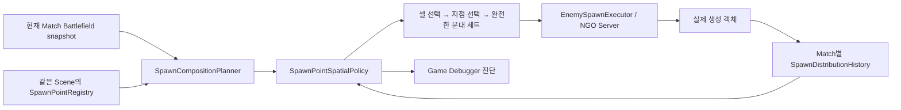

# 공간 기반 스폰 분산

**기준:** 게임 main `1a03e9a9164e5db94cbc8775162467d08cf63a3b` (2026-11-05), 공개 API·현재 구현 정적 대조.

스폰 분산은 스포너 개수가 아니라 적합한 Grid 셀의 공간 분포를 기준으로 합니다. 같은 셀에 Spawn Point가 여러 개 있어도 그 셀이 배수의 생성 비중을 얻지 않습니다.

## 배정 규칙

1. 생성 불가, Grid 밖, Player/Turret 점유 셀과 중복·누락 ID를 제외합니다.
2. 적합 후보를 Grid cell ID로 묶고 같은 셀의 현재 Enemy 수와 이번 요청 예정량을 공유합니다.
3. 셀 내부에서는 `point service + 예정량`이 가장 작은 지점을 고릅니다. 동률이면 전선 거리와 안정적인 ID를 사용합니다.
4. 셀은 `cell service + 현재 Enemy 수 + 예정량`이 작은 순서로 비교합니다.
5. 선택한 셀에 프리셋 한 세트를 배정합니다. 전체 예산을 넘기거나 프리셋을 부분 분해하지 않습니다.
6. 실행 뒤 실제 생성 객체 수만 service에 더합니다. 실패 계획은 소비하지 않고 부분 성공은 성공 수만 반영합니다.

`service`는 생성 기회를 분산하는 가상 부하입니다. 처치 수, 생존 수 또는 난이도 점수가 아닙니다. 적이 이동하거나 죽어도 이미 사용한 생성 기회가 초기화되지 않습니다.

다른 Match ID 또는 XY Grid 설정이 바뀌면 이력을 초기화합니다. 표시용 Z, revision, 전선 모양만 바뀐 경우에는 이력을 유지합니다.

## Game Debugger에서 확인

Statistics의 **Spawn decisions / distribution**에서 요청 당시 셀의 적 수, Cell service, Cell pending, Point service, 선택 사유와 실제 생성 결과를 함께 봅니다.

동일 조건 반복 실험에서는 지점별 합계와 함께 셀별 합계를 비교합니다. 한 셀에 지점이 네 개이고 다른 셀에 하나라면 셀 합계는 비슷해질 수 있지만 네 지점은 그 셀의 비중을 나눠 갖습니다.

자세한 화면 사용법은 [Spawn 판단과 분포 검사](../../../editor-tools/the-developer/game-debugger/spawn-inspection.md)를 확인하세요.

## 확장 origin 계약과 현재 실행 경계 — main 1a03e9a9

Core의 `EncounterRequest.Origin`은 Automatic·AuthoredPoint·DynamicSource·WorldPoint·WorldArea를 구분합니다. `CauseEventId`는 요청 GUID와 별도이며 의도/전달 방식도 재전송 충돌 비교에 포함됩니다. `IEncounterSpawnSourceRegistry.Register`의 lease는 source 수명 동안 보관하고, 이동은 TryUpdate, 제거는 Dispose로 처리하는 계약입니다.

`Initial_Stage`의 `EncounterSceneConfiguration`은 사용할 Executor를 명시합니다. Host는 `IEncounterOriginRequestTarget.RequestOrigin(...)`으로 즉시 요청하거나 `TryScheduleOrigin(..., delayGameSeconds, out requestId)`로 예약합니다. 예약은 게임 초를 따르고 Match/source 해제 시 취소되며, 실행 때 최신 공간·환경을 읽습니다. `PendingSpawnRequests`는 대기 건수입니다.

지원하는 전달 방식은 `Immediate`입니다. `GroundEmergence`·`AirDrop`에는 전달 어댑터가 필요합니다. 동적 source가 필요하면 유효한 등록을 유지하세요. 저장할 수 없는 동적 source 예약은 체크포인트에서 거부될 수 있습니다.

확장 계약 출처는 `Docs/architecture/encounter-spawn-origin-api.md`와 현재 Core/Enemy 조립부입니다. 문서에 남은 과거 실험의 생성 성공·시험 수치는 현재 Feature 인수로 사용하지 않습니다.

## 고정 편성과 상황별 편성

Game Debugger의 **Squad Preset Order** 요청은 지정한 편성을 사용합니다. Match 초기 요청도 런처의 `initialSquadOrder`를 사용하는 고정 요청입니다. 런처의 **Plan & Spawn** 또는 `RequestSpawn(out result)`는 최신 전장·지역·환경과 Core 난수로 지점별 편성을 선택합니다. `EncounterRequest.PresetId`는 명시 origin 요청에서 계속 필요합니다.

`SpawnBudgetPolicy.CalculateTotalBudget()`는 Core 지역 Grid의 점령 셀 비율에서 전체 예산을 계산합니다. Planner는 예산·배치 제약으로 명령을 만들고, Executor는 서버에서 생성에 성공한 결과만 분산 이력에 반영합니다.

## 정적 Region의 스폰 허용

지점을 `SpawnPointRegistry.Initialize(points)`로 등록한 뒤 Static Region snapshot으로 `InitializeRegionGroups(regionSnapshot)`을 호출합니다. XY 좌표의 셀에 지정된 Region ID로 묶으며 Grid 밖과 ID 0은 제외합니다. `SetRegionSpawnEnabled(regionId, enabled)`는 그룹의 스폰 허용 상태를 바꾸고 그룹이 없으면 false를 반환합니다. 개별적으로 차단된 지점은 Region을 다시 켜도 차단 상태를 유지합니다.

현재 Match가 Dynamic으로 전환되거나 종료되면 정적 그룹 제한을 해제합니다. 점령 상태로 자동 차단하려면 Core 호출부에서 `SetRegionSpawnEnabled`를 연결해야 합니다.
